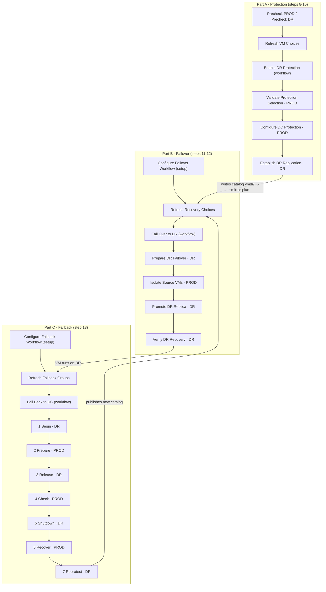

# Runbook playbooks: what each step runs and where it redirects

This page explains what happens behind every AAP job in [RUNBOOK.md](RUNBOOK.md): which **playbook** each job runs, where that playbook **hands off** to (roles and task files), and what each step creates or changes on which cluster.

- **Part A:** Protection (runbook steps 8–10)
- **Part B:** Failover (steps 11–12)
- **Part C:** Failback (step 13)

Code links point to commit [`c4cbb49`](https://github.com/mpmprock3/openshift-vm-dr-automation/tree/c4cbb49cc8e475b03506b10e1a6b8dba19e5f33a), which the AAP project runs after runbook step 13.1. The protection and failover playbooks there are the ones from `main` (steps 1–12), plus small additions the failback needs.

Example names (runbook lab): VM `default/dr-demo-vm` on PROD, DR namespace `vmdr`, plan `demo-vm-plan`, Application `demo-vm-plan-<hash>`, relationship `demo-vm-plan-<hash>-mirror`.

---

## 1. Complete flow



Arrows inside a workflow are **on success only**: a failed job stops everything after it. Each job uses **one** cluster credential (*· PROD* = **OpenShift PROD**, *· DR* = **OpenShift DR**). Jobs pass results to the next job as AAP workflow artifacts (`set_stats`).

---

## 2. How a playbook "redirects" (for Ansible newcomers)

Almost every playbook in the repository root is a thin wrapper:

```yaml
tasks:
  - ansible.builtin.include_role:      # 1. check the OpenShift credential AAP attached
      name: vmdr
      tasks_from: credentials          #    -> roles/vmdr/tasks/credentials.yml
  - ansible.builtin.include_role:      # 2. hand off to the real work
      name: vmdr
      tasks_from: dc                   #    -> roles/vmdr/tasks/dc.yml
```

`include_role … tasks_from: X` means *"now run `roles/<role>/tasks/X.yml`"*. Those files call more files with `include_tasks`, and render YAML templates from `roles/<role>/templates/` into Kubernetes objects. So the chain is always:

```text
AAP job ─► <playbook>.yml ─► roles/vmdr/tasks/credentials.yml
                          └► roles/<role>/tasks/<step>.yml ─► more task files / templates ─► OpenShift API
```

| Role | Used for |
|---|---|
| `vmdr` | Protection, failover, AAP setup and survey jobs, shared helpers ([`vmdr/survey_api`](https://github.com/mpmprock3/openshift-vm-dr-automation/blob/c4cbb49cc8e475b03506b10e1a6b8dba19e5f33a/roles/vmdr/tasks/survey_api.yml) for AAP API calls, [`vmdr/wait`](https://github.com/mpmprock3/openshift-vm-dr-automation/blob/c4cbb49cc8e475b03506b10e1a6b8dba19e5f33a/roles/vmdr/tasks/wait.yml), [`vmdr/ensure`](https://github.com/mpmprock3/openshift-vm-dr-automation/blob/c4cbb49cc8e475b03506b10e1a6b8dba19e5f33a/roles/vmdr/tasks/ensure.yml)) |
| `failback_continuation` | Failback glue: one task file per stage, plus checkpoint and resume |
| `label_recovery` | Failback's NetApp steps: enroll by label, establish, ShutdownSnapshot, promote, protect, reprotect |

---

## 3. Every job at a glance

| Runbook step | AAP job | Playbook → redirect | Cluster | What it does |
|---|---|---|---|---|
| 8 | Precheck PROD / Precheck DR | [`precheck_access.yml`](https://github.com/mpmprock3/openshift-vm-dr-automation/blob/c4cbb49cc8e475b03506b10e1a6b8dba19e5f33a/precheck_access.yml) (self-contained) | PROD / DR | Read-only: lists VMs, Applications, AppVaults and relationships through the attached credential |
| 9 | Refresh VM Choices | [`refresh_vm_choices.yml`](https://github.com/mpmprock3/openshift-vm-dr-automation/blob/c4cbb49cc8e475b03506b10e1a6b8dba19e5f33a/refresh_vm_choices.yml) → [`vmdr/refresh`](https://github.com/mpmprock3/openshift-vm-dr-automation/blob/c4cbb49cc8e475b03506b10e1a6b8dba19e5f33a/roles/vmdr/tasks/refresh.yml) | PROD | Lists PROD VMs and namespaces and writes them into the **Enable DR Protection** survey |
| 10 | Enable DR Protection → Validate Protection Selection | [`validate_protection.yml`](https://github.com/mpmprock3/openshift-vm-dr-automation/blob/c4cbb49cc8e475b03506b10e1a6b8dba19e5f33a/validate_protection.yml) → [`vmdr/validate`](https://github.com/mpmprock3/openshift-vm-dr-automation/blob/c4cbb49cc8e475b03506b10e1a6b8dba19e5f33a/roles/vmdr/tasks/validate.yml) | PROD | Checks the survey answers and VM disks, builds the protection plan |
| 10 | → Configure DC Protection | [`configure_dc_protection.yml`](https://github.com/mpmprock3/openshift-vm-dr-automation/blob/c4cbb49cc8e475b03506b10e1a6b8dba19e5f33a/configure_dc_protection.yml) → [`vmdr/dc`](https://github.com/mpmprock3/openshift-vm-dr-automation/blob/c4cbb49cc8e475b03506b10e1a6b8dba19e5f33a/roles/vmdr/tasks/dc.yml) | PROD | Application, first Snapshot, 5-min Schedule |
| 10 | → Establish DR Replication | [`establish_dr_replication.yml`](https://github.com/mpmprock3/openshift-vm-dr-automation/blob/c4cbb49cc8e475b03506b10e1a6b8dba19e5f33a/establish_dr_replication.yml) → [`vmdr/dr`](https://github.com/mpmprock3/openshift-vm-dr-automation/blob/c4cbb49cc8e475b03506b10e1a6b8dba19e5f33a/roles/vmdr/tasks/dr.yml) | DR | Creates the AppMirrorRelationship, waits for `Established`, saves the recovery catalog |
| 11 | Configure Failover Workflow | [`configure_failover_workflow.yml`](https://github.com/mpmprock3/openshift-vm-dr-automation/blob/c4cbb49cc8e475b03506b10e1a6b8dba19e5f33a/configure_failover_workflow.yml) → [`vmdr/configure_failover_ui`](https://github.com/mpmprock3/openshift-vm-dr-automation/blob/c4cbb49cc8e475b03506b10e1a6b8dba19e5f33a/roles/vmdr/tasks/configure_failover_ui.yml) | AAP only | Creates the 4 failover jobs, **Refresh Recovery Choices** and the **Fail Over to DR** workflow |
| 11–12 | Refresh Recovery Choices | [`refresh_recovery_choices.yml`](https://github.com/mpmprock3/openshift-vm-dr-automation/blob/c4cbb49cc8e475b03506b10e1a6b8dba19e5f33a/refresh_recovery_choices.yml) → [`vmdr/refresh_recovery`](https://github.com/mpmprock3/openshift-vm-dr-automation/blob/c4cbb49cc8e475b03506b10e1a6b8dba19e5f33a/roles/vmdr/tasks/refresh_recovery.yml) | DR | Fills the **Fail Over to DR** dropdown from the recovery catalogs |
| 12 | Fail Over to DR → Prepare DR Failover | [`prepare_failover.yml`](https://github.com/mpmprock3/openshift-vm-dr-automation/blob/c4cbb49cc8e475b03506b10e1a6b8dba19e5f33a/prepare_failover.yml) → [`vmdr/prepare_failover`](https://github.com/mpmprock3/openshift-vm-dr-automation/blob/c4cbb49cc8e475b03506b10e1a6b8dba19e5f33a/roles/vmdr/tasks/prepare_failover.yml) | DR | Checks the replica, DR compute and disks |
| 12 | → Isolate Source VMs | [`isolate_source.yml`](https://github.com/mpmprock3/openshift-vm-dr-automation/blob/c4cbb49cc8e475b03506b10e1a6b8dba19e5f33a/isolate_source.yml) → [`vmdr/isolate_source`](https://github.com/mpmprock3/openshift-vm-dr-automation/blob/c4cbb49cc8e475b03506b10e1a6b8dba19e5f33a/roles/vmdr/tasks/isolate_source.yml) | PROD | Pauses the PROD schedule and stops the PROD VM (or records external fencing) |
| 12 | → Promote DR Replica | [`promote_dr_replica.yml`](https://github.com/mpmprock3/openshift-vm-dr-automation/blob/c4cbb49cc8e475b03506b10e1a6b8dba19e5f33a/promote_dr_replica.yml) → [`vmdr/promote_failover`](https://github.com/mpmprock3/openshift-vm-dr-automation/blob/c4cbb49cc8e475b03506b10e1a6b8dba19e5f33a/roles/vmdr/tasks/promote_failover.yml) | DR | Sets the relationship to `Promoted` |
| 12 | → Verify DR Recovery | [`verify_dr_recovery.yml`](https://github.com/mpmprock3/openshift-vm-dr-automation/blob/c4cbb49cc8e475b03506b10e1a6b8dba19e5f33a/verify_dr_recovery.yml) → [`vmdr/verify_failover`](https://github.com/mpmprock3/openshift-vm-dr-automation/blob/c4cbb49cc8e475b03506b10e1a6b8dba19e5f33a/roles/vmdr/tasks/verify_failover.yml) | DR | Starts the recovered VM if needed, checks Running/Ready, optional health URL |
| 13 | Configure Failback Workflow | [`configure_failback_workflow.yml`](https://github.com/mpmprock3/openshift-vm-dr-automation/blob/c4cbb49cc8e475b03506b10e1a6b8dba19e5f33a/configure_failback_workflow.yml) → [`vmdr/configure_complete_failback`](https://github.com/mpmprock3/openshift-vm-dr-automation/blob/c4cbb49cc8e475b03506b10e1a6b8dba19e5f33a/roles/vmdr/tasks/configure_complete_failback.yml) | AAP only | Creates the 7 stage jobs, **Refresh Failback Groups** and the **Fail Back to DC** workflow and survey |
| 13 | Refresh Failback Groups | [`refresh_failback_groups.yml`](https://github.com/mpmprock3/openshift-vm-dr-automation/blob/c4cbb49cc8e475b03506b10e1a6b8dba19e5f33a/refresh_failback_groups.yml) → [`vmdr/refresh_failback`](https://github.com/mpmprock3/openshift-vm-dr-automation/blob/c4cbb49cc8e475b03506b10e1a6b8dba19e5f33a/roles/vmdr/tasks/refresh_failback.yml) | DR | Fills the **Fail Back to DC** dropdown with failed-over (Promoted) or interrupted groups |
| 13 | Fail Back to DC → 1 Begin Failback | [`begin_failback.yml`](https://github.com/mpmprock3/openshift-vm-dr-automation/blob/c4cbb49cc8e475b03506b10e1a6b8dba19e5f33a/begin_failback.yml) → [`failback_continuation/begin`](https://github.com/mpmprock3/openshift-vm-dr-automation/blob/c4cbb49cc8e475b03506b10e1a6b8dba19e5f33a/roles/failback_continuation/tasks/begin.yml) | DR | Enrolls the running DR VM by label (Application `fb-app-<id>`), baseline snapshot, checkpoint |
| 13 | → 2 Prepare Failback DC | [`prepare_failback_dc.yml`](https://github.com/mpmprock3/openshift-vm-dr-automation/blob/c4cbb49cc8e475b03506b10e1a6b8dba19e5f33a/prepare_failback_dc.yml) → [`failback_continuation/prepare`](https://github.com/mpmprock3/openshift-vm-dr-automation/blob/c4cbb49cc8e475b03506b10e1a6b8dba19e5f33a/roles/failback_continuation/tasks/prepare.yml) | PROD | Checks the old PROD VM is stopped, removes the old PROD schedule |
| 13 | → 3 Release Failback DR | [`release_failback_dr.yml`](https://github.com/mpmprock3/openshift-vm-dr-automation/blob/c4cbb49cc8e475b03506b10e1a6b8dba19e5f33a/release_failback_dr.yml) → [`failback_continuation/release`](https://github.com/mpmprock3/openshift-vm-dr-automation/blob/c4cbb49cc8e475b03506b10e1a6b8dba19e5f33a/roles/failback_continuation/tasks/release.yml) | DR | Deletes the old Promoted relationship (VM and disks stay) |
| 13 | → 4 Check Failback DC | [`check_failback_dc.yml`](https://github.com/mpmprock3/openshift-vm-dr-automation/blob/c4cbb49cc8e475b03506b10e1a6b8dba19e5f33a/check_failback_dc.yml) → [`failback_continuation/check`](https://github.com/mpmprock3/openshift-vm-dr-automation/blob/c4cbb49cc8e475b03506b10e1a6b8dba19e5f33a/roles/failback_continuation/tasks/check.yml) | PROD | Creates `prod-return-<id>` and DR → PROD replication, waits for a transfer, checks compute |
| 13 | → 5 Shutdown Failback DR | [`shutdown_failback_dr.yml`](https://github.com/mpmprock3/openshift-vm-dr-automation/blob/c4cbb49cc8e475b03506b10e1a6b8dba19e5f33a/shutdown_failback_dr.yml) → [`failback_continuation/shutdown`](https://github.com/mpmprock3/openshift-vm-dr-automation/blob/c4cbb49cc8e475b03506b10e1a6b8dba19e5f33a/roles/failback_continuation/tasks/shutdown.yml) | DR | **Final ShutdownSnapshot**, stops the DR VM (downtime starts) |
| 13 | → 6 Recover Failback DC | [`recover_failback_dc.yml`](https://github.com/mpmprock3/openshift-vm-dr-automation/blob/c4cbb49cc8e475b03506b10e1a6b8dba19e5f33a/recover_failback_dc.yml) → [`failback_continuation/recover`](https://github.com/mpmprock3/openshift-vm-dr-automation/blob/c4cbb49cc8e475b03506b10e1a6b8dba19e5f33a/roles/failback_continuation/tasks/recover.yml) | PROD | Promotes PROD at **that exact snapshot**, VM Running, PROD protection |
| 13 | → 7 Reprotect Failback DR | [`reprotect_failback_dr.yml`](https://github.com/mpmprock3/openshift-vm-dr-automation/blob/c4cbb49cc8e475b03506b10e1a6b8dba19e5f33a/reprotect_failback_dr.yml) → [`failback_continuation/reprotect`](https://github.com/mpmprock3/openshift-vm-dr-automation/blob/c4cbb49cc8e475b03506b10e1a6b8dba19e5f33a/roles/failback_continuation/tasks/reprotect.yml) | DR | PROD → DR replication, publishes the new catalog for **Fail Over to DR** |

---

## Part A · Protection (steps 8–10)

### Precheck PROD / Precheck DR: [`precheck_access.yml`](https://github.com/mpmprock3/openshift-vm-dr-automation/blob/c4cbb49cc8e475b03506b10e1a6b8dba19e5f33a/precheck_access.yml)

The only playbook that doesn't redirect. It reads the attached credential's API URL and token, then lists VMs, Trident Protect Applications, AppVaults and relationships with plain HTTP GETs. **Read-only**; it proves the credential points at the right cluster.

### Refresh VM Choices: [`refresh_vm_choices.yml`](https://github.com/mpmprock3/openshift-vm-dr-automation/blob/c4cbb49cc8e475b03506b10e1a6b8dba19e5f33a/refresh_vm_choices.yml) → [`vmdr/credentials`](https://github.com/mpmprock3/openshift-vm-dr-automation/blob/c4cbb49cc8e475b03506b10e1a6b8dba19e5f33a/roles/vmdr/tasks/credentials.yml), [`vmdr/refresh`](https://github.com/mpmprock3/openshift-vm-dr-automation/blob/c4cbb49cc8e475b03506b10e1a6b8dba19e5f33a/roles/vmdr/tasks/refresh.yml)

1. Lists all VMs on PROD, including stopped ones, and refuses an empty result.
2. Finds the **Enable DR Protection** workflow through the AAP API ([`vmdr/survey_api`](https://github.com/mpmprock3/openshift-vm-dr-automation/blob/c4cbb49cc8e475b03506b10e1a6b8dba19e5f33a/roles/vmdr/tasks/survey_api.yml), using the **AAP Survey Updater** credential).
3. Rewrites only the two dropdowns, *Select individual VMs* and *Select namespaces*, using `templates/survey.yaml.j2`. Before saving, it checks nobody edited the survey meanwhile, then reads the result back.

### Enable DR Protection (workflow: Validate → Configure DC → Establish DR)

#### 1. Validate Protection Selection (PROD): [`validate_protection.yml`](https://github.com/mpmprock3/openshift-vm-dr-automation/blob/c4cbb49cc8e475b03506b10e1a6b8dba19e5f33a/validate_protection.yml) → [`vmdr/validate`](https://github.com/mpmprock3/openshift-vm-dr-automation/blob/c4cbb49cc8e475b03506b10e1a6b8dba19e5f33a/roles/vmdr/tasks/validate.yml)

- Checks the survey answers (scope versus lists, single-select mapping, interval of at least 5 min, via [`vmdr/validate_interval`](https://github.com/mpmprock3/openshift-vm-dr-automation/blob/c4cbb49cc8e475b03506b10e1a6b8dba19e5f33a/roles/vmdr/tasks/validate_interval.yml)).
- Expands *namespaces* into VMs ([`vmdr/select_namespace`](https://github.com/mpmprock3/openshift-vm-dr-automation/blob/c4cbb49cc8e475b03506b10e1a6b8dba19e5f33a/roles/vmdr/tasks/select_namespace.yml)).
- Checks every VM and its disks ([`vmdr/validate_vm`](https://github.com/mpmprock3/openshift-vm-dr-automation/blob/c4cbb49cc8e475b03506b10e1a6b8dba19e5f33a/roles/vmdr/tasks/validate_vm.yml)).
- Builds the namespace mapping, for example `default → vmdr`.
- Passes the **resolved plan** to the next job with `set_stats`. Nothing is created.

#### 2. Configure DC Protection (PROD): [`configure_dc_protection.yml`](https://github.com/mpmprock3/openshift-vm-dr-automation/blob/c4cbb49cc8e475b03506b10e1a6b8dba19e5f33a/configure_dc_protection.yml) → [`vmdr/dc`](https://github.com/mpmprock3/openshift-vm-dr-automation/blob/c4cbb49cc8e475b03506b10e1a6b8dba19e5f33a/roles/vmdr/tasks/dc.yml)

1. Checks the AppVault ([`vmdr/vault`](https://github.com/mpmprock3/openshift-vm-dr-automation/blob/c4cbb49cc8e475b03506b10e1a6b8dba19e5f33a/roles/vmdr/tasks/vault.yml)) and builds a precise selection of the VM and its disks ([`vmdr/dependencies`](https://github.com/mpmprock3/openshift-vm-dr-automation/blob/c4cbb49cc8e475b03506b10e1a6b8dba19e5f33a/roles/vmdr/tasks/dependencies.yml)).
2. Creates Application `default/demo-vm-plan-<hash>` from `templates/application.yaml.j2` ([`vmdr/ensure`](https://github.com/mpmprock3/openshift-vm-dr-automation/blob/c4cbb49cc8e475b03506b10e1a6b8dba19e5f33a/roles/vmdr/tasks/ensure.yml) creates the object or verifies it), then waits for Ready ([`vmdr/wait`](https://github.com/mpmprock3/openshift-vm-dr-automation/blob/c4cbb49cc8e475b03506b10e1a6b8dba19e5f33a/roles/vmdr/tasks/wait.yml)).
3. Takes the first Snapshot `…-initial` (`snapshot.yaml.j2`) and waits for `Completed`.
4. Adds Schedule `…-schedule` (`schedule.yaml.j2`, every 5 min).
5. Passes the Application name and UID to the DR job.

#### 3. Establish DR Replication (DR): [`establish_dr_replication.yml`](https://github.com/mpmprock3/openshift-vm-dr-automation/blob/c4cbb49cc8e475b03506b10e1a6b8dba19e5f33a/establish_dr_replication.yml) → [`vmdr/dr`](https://github.com/mpmprock3/openshift-vm-dr-automation/blob/c4cbb49cc8e475b03506b10e1a6b8dba19e5f33a/roles/vmdr/tasks/dr.yml)

1. Checks that DR can read the same AppVault, the destination vault, and the Trident storage class.
2. Refuses to reset a relationship that's already in recovery.
3. Prepares namespace `vmdr` ([`vmdr/namespace`](https://github.com/mpmprock3/openshift-vm-dr-automation/blob/c4cbb49cc8e475b03506b10e1a6b8dba19e5f33a/roles/vmdr/tasks/namespace.yml)) and refuses to overwrite existing workloads there ([`vmdr/destination_collision`](https://github.com/mpmprock3/openshift-vm-dr-automation/blob/c4cbb49cc8e475b03506b10e1a6b8dba19e5f33a/roles/vmdr/tasks/destination_collision.yml)).
4. Creates AppMirrorRelationship `vmdr/demo-vm-plan-<hash>-mirror` (`appmirrorrelationship.yaml.j2`, `desiredState: Established`). It waits and checks the transfer ([`vmdr/poll_mirror`](https://github.com/mpmprock3/openshift-vm-dr-automation/blob/c4cbb49cc8e475b03506b10e1a6b8dba19e5f33a/roles/vmdr/tasks/poll_mirror.yml)).
5. **Saves the recovery catalog** ConfigMap `vmdr/demo-vm-plan-<hash>-mirror-plan` ([`vmdr/catalog`](https://github.com/mpmprock3/openshift-vm-dr-automation/blob/c4cbb49cc8e475b03506b10e1a6b8dba19e5f33a/roles/vmdr/tasks/catalog.yml)). Failover and failback both read their settings from this ConfigMap later.

---

## Part B · Failover (steps 11–12)

### Configure Failover Workflow (setup): [`configure_failover_workflow.yml`](https://github.com/mpmprock3/openshift-vm-dr-automation/blob/c4cbb49cc8e475b03506b10e1a6b8dba19e5f33a/configure_failover_workflow.yml) → [`vmdr/configure_failover_ui`](https://github.com/mpmprock3/openshift-vm-dr-automation/blob/c4cbb49cc8e475b03506b10e1a6b8dba19e5f33a/roles/vmdr/tasks/configure_failover_ui.yml)

1. Reads **Configure DC Protection**, **Establish DR Replication** and **Refresh VM Choices** and copies their project, inventory, EE and credentials ([`vmdr/read_base_template`](https://github.com/mpmprock3/openshift-vm-dr-automation/blob/c4cbb49cc8e475b03506b10e1a6b8dba19e5f33a/roles/vmdr/tasks/read_base_template.yml)). Reads **Enable DR Protection** for the organization ([`vmdr/resolve_failover_organization`](https://github.com/mpmprock3/openshift-vm-dr-automation/blob/c4cbb49cc8e475b03506b10e1a6b8dba19e5f33a/roles/vmdr/tasks/resolve_failover_organization.yml)).
2. Creates or verifies 5 job templates ([`vmdr/configure_failover_job`](https://github.com/mpmprock3/openshift-vm-dr-automation/blob/c4cbb49cc8e475b03506b10e1a6b8dba19e5f33a/roles/vmdr/tasks/configure_failover_job.yml)): Prepare DR Failover, Isolate Source VMs, Promote DR Replica, Verify DR Recovery, Refresh Recovery Choices.
3. Creates the **Fail Over to DR** workflow (concurrent launches off), installs its survey, and links the 4 stages with success-only edges ([`vmdr/configure_failover_node`](https://github.com/mpmprock3/openshift-vm-dr-automation/blob/c4cbb49cc8e475b03506b10e1a6b8dba19e5f33a/roles/vmdr/tasks/configure_failover_node.yml)). It never launches anything.

### Refresh Recovery Choices (DR): [`refresh_recovery_choices.yml`](https://github.com/mpmprock3/openshift-vm-dr-automation/blob/c4cbb49cc8e475b03506b10e1a6b8dba19e5f33a/refresh_recovery_choices.yml) → [`vmdr/refresh_recovery`](https://github.com/mpmprock3/openshift-vm-dr-automation/blob/c4cbb49cc8e475b03506b10e1a6b8dba19e5f33a/roles/vmdr/tasks/refresh_recovery.yml)

Finds every recovery catalog on DR (`component=recovery-plan`) and writes `vmdr/demo-vm-plan-<hash>-mirror` into the **Protected VM group** dropdown (`recovery-survey.yaml.j2`). It refuses concurrent survey edits.

### Fail Over to DR (workflow: Prepare → Isolate → Promote → Verify)

#### 1. Prepare DR Failover (DR): [`prepare_failover.yml`](https://github.com/mpmprock3/openshift-vm-dr-automation/blob/c4cbb49cc8e475b03506b10e1a6b8dba19e5f33a/prepare_failover.yml) → [`vmdr/prepare_failover`](https://github.com/mpmprock3/openshift-vm-dr-automation/blob/c4cbb49cc8e475b03506b10e1a6b8dba19e5f33a/roles/vmdr/tasks/prepare_failover.yml)

- Loads the catalog ([`vmdr/load_recovery`](https://github.com/mpmprock3/openshift-vm-dr-automation/blob/c4cbb49cc8e475b03506b10e1a6b8dba19e5f33a/roles/vmdr/tasks/load_recovery.yml)) and checks the relationship, request ID and snapshot age ([`vmdr/recovery_guard`](https://github.com/mpmprock3/openshift-vm-dr-automation/blob/c4cbb49cc8e475b03506b10e1a6b8dba19e5f33a/roles/vmdr/tasks/recovery_guard.yml)).
- Checks that DR can run VMs: KVM, or emulation when `protect_allow_emulation` is set ([`vmdr/recovery_compute`](https://github.com/mpmprock3/openshift-vm-dr-automation/blob/c4cbb49cc8e475b03506b10e1a6b8dba19e5f33a/roles/vmdr/tasks/recovery_compute.yml)).
- Checks the disks and that no unrelated VMs are present ([`vmdr/recovery_destination`](https://github.com/mpmprock3/openshift-vm-dr-automation/blob/c4cbb49cc8e475b03506b10e1a6b8dba19e5f33a/roles/vmdr/tasks/recovery_destination.yml)).
- Passes the prepared plan on. Nothing is changed.

#### 2. Isolate Source VMs (PROD): [`isolate_source.yml`](https://github.com/mpmprock3/openshift-vm-dr-automation/blob/c4cbb49cc8e475b03506b10e1a6b8dba19e5f33a/isolate_source.yml) → [`vmdr/isolate_source`](https://github.com/mpmprock3/openshift-vm-dr-automation/blob/c4cbb49cc8e475b03506b10e1a6b8dba19e5f33a/roles/vmdr/tasks/isolate_source.yml)

For **Stop source VMs**:
1. Checks the PROD Application is the enrolled one.
2. **Pauses the PROD schedule** (`enabled: false`, without taking a final snapshot).
3. **Stops each PROD VM** and waits for its VMI to disappear ([`vmdr/halt_source_vm`](https://github.com/mpmprock3/openshift-vm-dr-automation/blob/c4cbb49cc8e475b03506b10e1a6b8dba19e5f33a/roles/vmdr/tasks/halt_source_vm.yml)).

For **Source externally fenced**, it records your fencing reference and makes no PROD API call.

#### 3. Promote DR Replica (DR): [`promote_dr_replica.yml`](https://github.com/mpmprock3/openshift-vm-dr-automation/blob/c4cbb49cc8e475b03506b10e1a6b8dba19e5f33a/promote_dr_replica.yml) → [`vmdr/promote_failover`](https://github.com/mpmprock3/openshift-vm-dr-automation/blob/c4cbb49cc8e475b03506b10e1a6b8dba19e5f33a/roles/vmdr/tasks/promote_failover.yml)

Reloads the plan and checks the isolation evidence ([`vmdr/isolation_guard`](https://github.com/mpmprock3/openshift-vm-dr-automation/blob/c4cbb49cc8e475b03506b10e1a6b8dba19e5f33a/roles/vmdr/tasks/isolation_guard.yml)) and the recovery point again. It then patches the relationship to **`desiredState: Promoted`**, tagging it with the request ID and checking its identity atomically, and waits for `Promoted`. Trident Protect restores the VM in `vmdr` from the **latest replicated snapshot**. Writes made after that snapshot are lost, which is expected in a disaster failover.

#### 4. Verify DR Recovery (DR): [`verify_dr_recovery.yml`](https://github.com/mpmprock3/openshift-vm-dr-automation/blob/c4cbb49cc8e475b03506b10e1a6b8dba19e5f33a/verify_dr_recovery.yml) → [`vmdr/verify_failover`](https://github.com/mpmprock3/openshift-vm-dr-automation/blob/c4cbb49cc8e475b03506b10e1a6b8dba19e5f33a/roles/vmdr/tasks/verify_failover.yml)

Checks the relationship is still the promoted one from this request. Checks each restored VM and its disks, starting it if needed ([`vmdr/verify_recovered_vm`](https://github.com/mpmprock3/openshift-vm-dr-automation/blob/c4cbb49cc8e475b03506b10e1a6b8dba19e5f33a/roles/vmdr/tasks/verify_recovered_vm.yml)), then waits for Running/Ready. Calls the optional health URL and reports the result.

---

## Part C · Failback (step 13)

Every failback stage playbook calls [`vmdr/credentials`](https://github.com/mpmprock3/openshift-vm-dr-automation/blob/c4cbb49cc8e475b03506b10e1a6b8dba19e5f33a/roles/vmdr/tasks/credentials.yml) and then **one** file in `roles/failback_continuation/tasks/`. That file calls the shared `label_recovery` tasks, which do the Trident Protect work. This follows the [NetApp blog](https://community.netapp.com/community/discussion/460716/openshift-virtualization-disaster-recovery-with-netapp-trident-protect)'s sequence: reverse resync → final ShutdownSnapshot → fail over at that snapshot → resync back.

#### What setup does ([`configure_complete_failback.yml`](https://github.com/mpmprock3/openshift-vm-dr-automation/blob/c4cbb49cc8e475b03506b10e1a6b8dba19e5f33a/roles/vmdr/tasks/configure_complete_failback.yml))

1. Reads **Configure DC Protection**, **Establish DR Replication** and **Refresh VM Choices**, and requires the first two to use the same project. It reuses their inventory, project, EE and credentials.
2. Creates or verifies the 7 stage jobs and **Refresh Failback Groups**. It rejects existing templates whose settings differ, rather than overwriting them.
3. Reads **Enable DR Protection** for the AAP organization, then creates the **Fail Back to DC** workflow. Its extra variables include `protect_allow_emulation` copied from the inventory.
4. Links the 7 stages with success-only edges and installs the survey through the refresh logic.
5. **It never launches a failback and never touches a VM.**

#### What refresh does ([`refresh_failback.yml`](https://github.com/mpmprock3/openshift-vm-dr-automation/blob/c4cbb49cc8e475b03506b10e1a6b8dba19e5f33a/roles/vmdr/tasks/refresh_failback.yml))

It reads on DR:
- the **Fail Over to DR** catalogs (`<mirror>-plan` ConfigMaps)
- their relationships
- any unfinished checkpoint records

It lists a group when its relationship is **Promoted** (failed over) or a failback for it is in progress (checkpoint phase not `complete`). It then writes the survey:

| Survey question | Variable |
|---|---|
| Which protected VM group should return to DC? | `failback_group`, e.g. `demo-vm-plan (default/dr-demo-vm) \| vmdr/demo-vm-plan-<hash>-mirror` |
| Where should the VM return on PROD? | `failback_destination_policy`; only choice: **Dedicated PROD namespace (retain old copy)** |
| Optional DC application health URL | `failback_health_url` |

### The seven stages

#### Stage 1: Begin Failback (DR, no downtime)

**Chain:** `begin_failback.yml` → [`failback_continuation/begin.yml`](https://github.com/mpmprock3/openshift-vm-dr-automation/blob/c4cbb49cc8e475b03506b10e1a6b8dba19e5f33a/roles/failback_continuation/tasks/begin.yml) → [`vmdr/resolve_failback_selection`](https://github.com/mpmprock3/openshift-vm-dr-automation/blob/c4cbb49cc8e475b03506b10e1a6b8dba19e5f33a/roles/vmdr/tasks/resolve_failback_selection.yml), [`vmdr/assess_failback_dr`](https://github.com/mpmprock3/openshift-vm-dr-automation/blob/c4cbb49cc8e475b03506b10e1a6b8dba19e5f33a/roles/vmdr/tasks/assess_failback_dr.yml), [`label_recovery/enroll`](https://github.com/mpmprock3/openshift-vm-dr-automation/blob/c4cbb49cc8e475b03506b10e1a6b8dba19e5f33a/roles/label_recovery/tasks/enroll.yml), [`failback_continuation/save`](https://github.com/mpmprock3/openshift-vm-dr-automation/blob/c4cbb49cc8e475b03506b10e1a6b8dba19e5f33a/roles/failback_continuation/tasks/save.yml)

1. Turns the survey choice into the failover relationship `vmdr/demo-vm-plan-<hash>-mirror`, and refuses to overlap an older filter-based failback attempt.
2. Loads the checkpoint `vmdr/continue-<id>` if a previous run exists. A completed earlier cycle is archived first.
3. On a first run, reads the **Fail Over to DR** catalog and the running DR VMs and disks. It requires a **dedicated** DR namespace containing only the group's VMs and disks.
4. Works out the names: new Application `fb-app-<id>`, and PROD namespace `prod-return-<id>` (first cycle) or the namespace from the previous cycle.
5. **Enrolls the running DR VM** (`label_recovery/enroll`):
   - labels the VM and its disks `vmdr.aap/protection-group=fb-app-<id>`
   - creates Application `vmdr/fb-app-<id>`
   - takes a retained baseline snapshot and checks it contains exactly those disks
   - adds a snapshot schedule
6. Saves the checkpoint with phase `discovered`, then `enrolled`.

#### Stage 2: Prepare Failback DC (PROD, no downtime)

**Chain:** `prepare_failback_dc.yml` → [`failback_continuation/prepare.yml`](https://github.com/mpmprock3/openshift-vm-dr-automation/blob/c4cbb49cc8e475b03506b10e1a6b8dba19e5f33a/roles/failback_continuation/tasks/prepare.yml) → [`vmdr/assess_failback_dc`](https://github.com/mpmprock3/openshift-vm-dr-automation/blob/c4cbb49cc8e475b03506b10e1a6b8dba19e5f33a/roles/vmdr/tasks/assess_failback_dc.yml), [`vmdr/reverse_remove_schedule`](https://github.com/mpmprock3/openshift-vm-dr-automation/blob/c4cbb49cc8e475b03506b10e1a6b8dba19e5f33a/roles/vmdr/tasks/reverse_remove_schedule.yml)

1. Checks the original PROD Application `default/demo-vm-plan-<hash>` and that the old `default/dr-demo-vm` is **stopped**.
2. Refuses an already-existing target namespace on the first copy, so nothing is ever overwritten.
3. Deletes only the old PROD Application's **managed** snapshot schedule. Existing snapshots are kept.

#### Stage 3: Release Failback DR (DR, no downtime)

**Chain:** `release_failback_dr.yml` → [`failback_continuation/release.yml`](https://github.com/mpmprock3/openshift-vm-dr-automation/blob/c4cbb49cc8e475b03506b10e1a6b8dba19e5f33a/roles/failback_continuation/tasks/release.yml) → `vmdr/reverse_remove_schedule`

1. Requires the exact Promoted relationship recorded at failover.
2. **Deletes the old promoted relationship** `vmdr/demo-vm-plan-<hash>-mirror`, with UID and resourceVersion preconditions. The VM, its disks and the Applications stay. This is the blog's "Delete AMR CR on Region B". It never sets the relationship back to `Established`, because that would discard the DR writes.
3. Removes old managed DR schedules that belonged to the legacy Application.

#### Stage 4: Check Failback DC (PROD, no downtime)

**Chain:** `check_failback_dc.yml` → [`failback_continuation/check.yml`](https://github.com/mpmprock3/openshift-vm-dr-automation/blob/c4cbb49cc8e475b03506b10e1a6b8dba19e5f33a/roles/failback_continuation/tasks/check.yml) → [`failback_continuation/target`](https://github.com/mpmprock3/openshift-vm-dr-automation/blob/c4cbb49cc8e475b03506b10e1a6b8dba19e5f33a/roles/failback_continuation/tasks/target.yml), [`label_recovery/establish`](https://github.com/mpmprock3/openshift-vm-dr-automation/blob/c4cbb49cc8e475b03506b10e1a6b8dba19e5f33a/roles/label_recovery/tasks/establish.yml), [`label_recovery/check_cutover`](https://github.com/mpmprock3/openshift-vm-dr-automation/blob/c4cbb49cc8e475b03506b10e1a6b8dba19e5f33a/roles/label_recovery/tasks/check_cutover.yml)

1. On later cycles, `target.yml` checks that the retained PROD namespace holds only the stopped, enrolled copy.
2. **Starts DR → PROD replication** (`establish`): creates namespace `prod-return-<id>` and AMR `prod-return-<id>/fb-app-<id>-mirror`, with DR's Application as the source. It waits for `Established` plus a successful transfer and checks the PROD disks are `Bound`. This is the blog's "Create new AMR on Region A".
3. `check_cutover` rechecks the replica and that PROD can run VMs (KVM, or emulation when allowed).
4. On retries after promotion, it recognizes the saved PROD receipt and skips these steps.

#### Stage 5: Shutdown Failback DR (DR, downtime starts)

**Chain:** `shutdown_failback_dr.yml` → [`failback_continuation/shutdown.yml`](https://github.com/mpmprock3/openshift-vm-dr-automation/blob/c4cbb49cc8e475b03506b10e1a6b8dba19e5f33a/roles/failback_continuation/tasks/shutdown.yml) → [`label_recovery/shutdown`](https://github.com/mpmprock3/openshift-vm-dr-automation/blob/c4cbb49cc8e475b03506b10e1a6b8dba19e5f33a/roles/label_recovery/tasks/shutdown.yml)

1. Saves the target identity before anything is stopped.
2. Disables the DR schedules, then creates the **final ShutdownSnapshot**. This stops the DR VM; it's the blog's "ShutdownSnapshot on Region B".
3. Checks the snapshot:
   - it's `Completed`
   - it covers exactly the enrolled disk IDs
   - its archive path is valid
   - the DR VMI is gone and the VM can't restart itself
4. Refuses to replace a final snapshot already recorded by an earlier attempt. Saves phase `isolated`.

#### Stage 6: Recover Failback DC (PROD, VM comes up)

**Chain:** `recover_failback_dc.yml` → [`failback_continuation/recover.yml`](https://github.com/mpmprock3/openshift-vm-dr-automation/blob/c4cbb49cc8e475b03506b10e1a6b8dba19e5f33a/roles/failback_continuation/tasks/recover.yml) → [`label_recovery/promote`](https://github.com/mpmprock3/openshift-vm-dr-automation/blob/c4cbb49cc8e475b03506b10e1a6b8dba19e5f33a/roles/label_recovery/tasks/promote.yml), [`label_recovery/activate_protection`](https://github.com/mpmprock3/openshift-vm-dr-automation/blob/c4cbb49cc8e475b03506b10e1a6b8dba19e5f33a/roles/label_recovery/tasks/activate_protection.yml)

1. **Promotes PROD at exactly the final snapshot:** it sets `promotedSnapshot: <archive basename>` and `desiredState: Promoted`. This is the blog's "fail over using the snapshot basename".
2. Waits for `Promoted`, starts the VM if it was restored stopped, and waits for `Running` / Ready. It then saves a receipt ConfigMap in `prod-return-<id>`.
3. `activate_protection` releases the promoted PROD relationship and adds a baseline snapshot and schedule on PROD.
4. Calls the health URL if you gave one (expects HTTP 200).

#### Stage 7: Reprotect Failback DR (DR, protection restored)

**Chain:** `reprotect_failback_dr.yml` → [`failback_continuation/reprotect.yml`](https://github.com/mpmprock3/openshift-vm-dr-automation/blob/c4cbb49cc8e475b03506b10e1a6b8dba19e5f33a/roles/failback_continuation/tasks/reprotect.yml) → [`label_recovery/reprotect`](https://github.com/mpmprock3/openshift-vm-dr-automation/blob/c4cbb49cc8e475b03506b10e1a6b8dba19e5f33a/roles/label_recovery/tasks/reprotect.yml)

1. **Restores PROD → DR replication:** removes the disabled DR schedules and creates AMR `vmdr/fb-app-<id>-mirror` from the PROD Application. It waits for a successful transfer. This is the blog's "Reverse resync Region A → Region B".
2. **Publishes a new failover catalog** `vmdr/fb-app-<id>-mirror-plan`, so **Fail Over to DR** offers the group again, now with source `prod-return-<id>`.
3. Re-labels the old catalog `demo-vm-plan-<hash>-mirror-plan` as `retired-recovery-plan`, which removes the stale dropdown entry.
4. Saves phase `complete`.

### How failback state moves between stages

| Where | Name | Holds |
|---|---|---|
| AAP workflow artifacts (`set_stats`) | `continuation_state`, `continuation_record_name`, plus cutover/snapshot data | Passed from each stage to the next inside one workflow run |
| DR ConfigMap | `vmdr/continue-<id>` (label `component=failback-continuation`) | The same state, durable. Phase: `discovered` → `enrolled` → `isolated` → `complete` |
| PROD ConfigMap | `<final-snapshot>-receipt` in `prod-return-<id>` | Proof of which snapshot was promoted, used by retries after stage 6 |
| DR ConfigMap | `vmdr/fb-app-<id>-mirror-plan` | New catalog for the next **Fail Over to DR** |

**Retry:** relaunch the **whole** workflow with the same group. Each stage reads the checkpoint, skips work that's already done, and rechecks identities. For example, after stage 5 it never takes a second final snapshot, and after stage 6 it never promotes again. Don't delete these ConfigMaps; they're the retry record.

### Objects after a successful failback

| Cluster | Object | Meaning |
|---|---|---|
| PROD | Namespace `prod-return-<id>`, VM `dr-demo-vm` Running | The recovered VM |
| PROD | Application `fb-app-<id>`, schedule, baseline snapshot | PROD is protected |
| PROD | `default/dr-demo-vm` Stopped | Old copy, retained. Never start it |
| DR | AMR `vmdr/fb-app-<id>-mirror` Established | PROD → DR replication |
| DR | ConfigMaps `continue-<id>`, `fb-app-<id>-mirror-plan` | Checkpoint and next-failover catalog |
| DR | Retained ShutdownSnapshot `…final…` | The exact recovery point used |

---

See also: [RUNBOOK.md](RUNBOOK.md) · [SURVEY-GUIDE-AND-TESTS.md](SURVEY-GUIDE-AND-TESTS.md) · [LAB-FAILBACK-EASY.md](https://github.com/mpmprock3/openshift-vm-dr-automation/blob/eb83b6d/docs/LAB-FAILBACK-EASY.md) · [FAILBACK-CONTINUATION.md](https://github.com/mpmprock3/openshift-vm-dr-automation/blob/eb83b6d/docs/FAILBACK-CONTINUATION.md)
